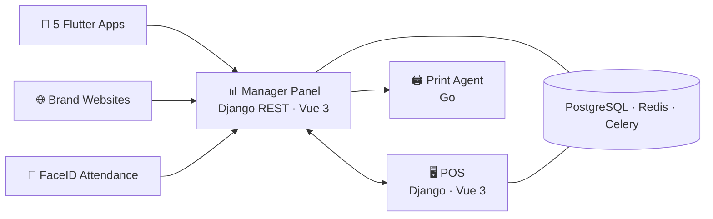

<h1 align="center">Hi, I'm Arslan</h1>
<p align="center">
  <b>Full-Stack Developer → Cybersecurity</b><br/>
  I build production systems end to end — and I want to know exactly how they break.
</p>

---

## About Me

I design, build, deploy and secure real-world software for businesses: from Django backends and Vue frontends to Flutter mobile apps, hardware integrations and the Linux servers they run on.
Shipping and maintaining production systems taught me where things go wrong — that's what pulls me toward **cybersecurity**, where I'm heading next.

---

## 🏗️ Flagship: POS Ecosystem

<p align="center">
  <i>A complete automation platform for a multi-brand café & restaurant chain — running in production every day.</i>
</p>

<p align="center">
  
  
  
  
  
</p>



<table>
<tr>
<td width="33%" valign="top">

#### 🖥️ POS
Touch-screen point-of-sale for cashiers: orders, payments, discounts, receipts.

`Django` `Celery` `Vue 3` `TypeScript`

</td>
<td width="33%" valign="top">

#### 📊 Manager Panel
Warehouse & inventory, recipes and tech cards, write-offs, reports, multi-brand menus.

`Django REST` `Vue 3` `TypeScript`

</td>
<td width="33%" valign="top">

#### 📱 Mobile Apps
Five apps: client, delivery, waiter, director and digital menu.

`Flutter` `Dart`

</td>
</tr>
<tr>
<td width="33%" valign="top">

#### 👤 FaceID Attendance
Employee check-in by face recognition, synced with the manager panel.

`Django`

</td>
<td width="33%" valign="top">

#### 🖨️ Print Agent
Tiny Windows agent (down to Win 7) that sends labels from the browser straight to the printer. Built by GitHub Actions, releases with SHA-256 checksums.

`Go` `GitHub Actions`

</td>
<td width="33%" valign="top">

#### 🌐 Brand Websites
Public websites for each brand of the chain.

`React` `Vite` `Tailwind`

</td>
</tr>
</table>

> 🔒 Private codebase — happy to walk through the architecture in an interview.

---

## Selected Projects

- **[Vienna Cars](https://vienna-cars.at)** — bilingual (EN/DE) luxury car rental platform with its own admin panel.
- **[Cedar Mining](https://cedarmining.com)** — corporate website for a mining company.
- **Technohaus** — landing page for an electronics & home-tech brand.
- **Laurastar** — product landing page for a premium garment-care brand.

---

## Security

<table>
<tr>
<td width="50%" valign="top">

### 🛡️ Defense — in production

Every server I run is hardened by me:

```bash
$ ./server-audit.sh
[✔] SSH        key-only authentication
[✔] Firewall   ufw, minimal open ports
[✔] fail2ban   brute-force protection
[✔] TLS        Let's Encrypt via certbot
[✔] Backups    regular database dumps
```

</td>
<td width="50%" valign="top">

### ⚔️ Offense — learning

Hands-on practice on **TryHackMe**:

- 🌐 Web application pentesting
- 🔎 Reconnaissance & scanning
- 💥 Exploitation basics

<p>
  
  
  
  
  
</p>

</td>
</tr>
</table>

---

## Where I'm Going

My goal is to become a **security specialist**. Next steps:
- Keep progressing on TryHackMe and start HackTheBox
- Focus on web application security — the area I know best as a developer
- Earn my first security certification

---

## Tech Stack

**Backend**
<p></p>

**Frontend**
<p></p>

**Mobile**
<p></p>

**DevOps & Security**
<p></p>

---

## Contact

[LinkedIn](https://www.linkedin.com/in/arslan-atayew-86b965304/) · arsyakmar@gmail.com
